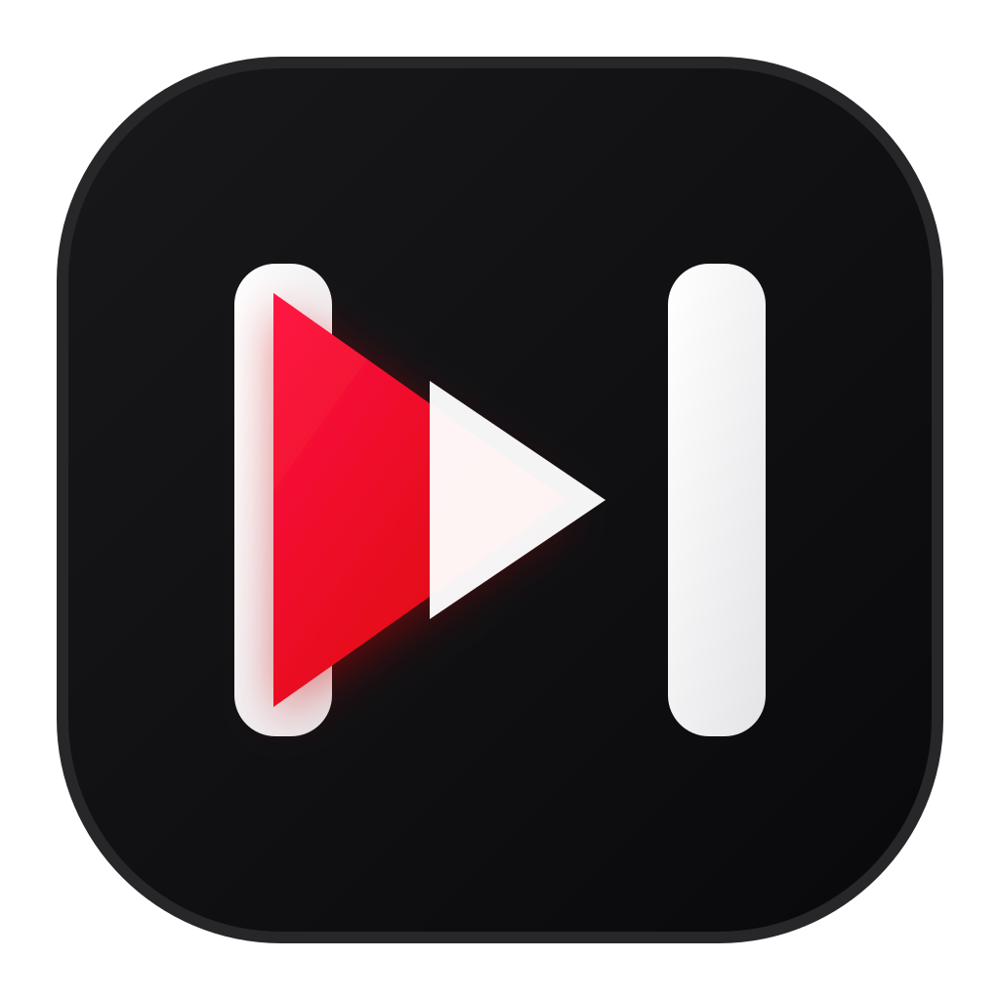

#  NeoTube

A clean, distraction-free YouTube and YouTube Music client for mobile (Android & iOS).

Forked from [NouTube](https://github.com/nonbili/NouTube) under the AGPLv3 license with a focus on modern mobile and tablet experience.

---

## Highlights & Features

- **Ad-Free Playback:** Native ad blocking directly inside the webview.
- **Background & Lock Screen Playback:** Keeps playing when minimized or when the screen is locked.
- **Native Miniplayer:** Collapse any playing video to a floating miniplayer with a simple swipe down gesture.
- **Customizable Layout:**
  - Vertical right-hand sidebar navigation toggle for tablets and large screens.
  - Optional hidden top navigation toolbar.
  - Distraction-free controls (hide Shorts, hide community posts, hide mix playlists).
- **Integrated SponsorBlock:** Automatically skips sponsors, intros, self-promos, and interaction reminders.
- **Privacy First:**
  - Manage library, bookmarks, and watch history locally without logging in to Google.
  - Local settings persistence with MMKV.
- **Clean Landing Screen:** Quick launcher for YouTube and customizable settings.

---

## Tech Stack

- **Framework:** React Native (New Architecture / Bridgeless) with Expo SDK 54
- **State Management:** `@legendapp/state` with MMKV persistence
- **Styling:** NativeWind (Tailwind CSS) & dynamic system color theme
- **Runtime & Tools:** Bun & Node.js

---

## Development & Building

### Prerequisites

- [Bun](https://bun.sh/)
- Android SDK (for Android builds)
- Node.js 20+

### Setup

```bash
# Install dependencies
bun install

# Start development Metro bundler
bun run start
```

### Android Build

```bash
# Build standalone debug APK
cd android && ./gradlew assembleFullDebug
```

---

## License

This project is licensed under the [GNU Affero General Public License v3.0 (AGPLv3)](./LICENSE).  
Original work copyright (C) rnons / NouTube contributors. Modifications and enhancements copyright (C) NeoTube contributors.
